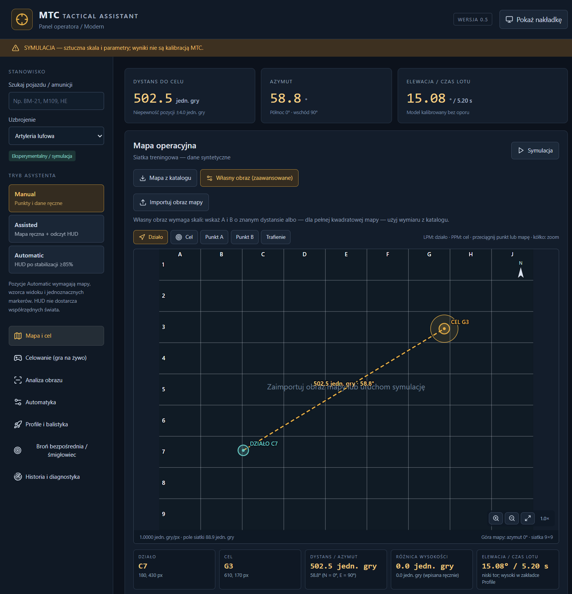
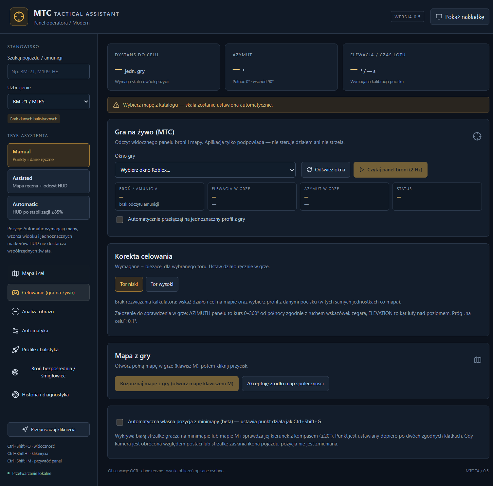
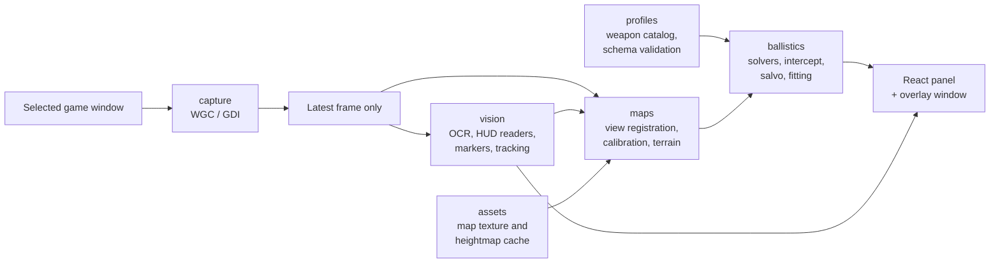

# MTC Tactical Assistant

A Windows desktop app that reads the visible screen of the Roblox game *Multicrew Tank Combat* and turns map positions and weapon data into a firing solution, shown in a transparent overlay above the game.



*Main panel in simulation mode (synthetic grid and parameters). The UI is in Polish.*

## What it does

- **Map calculator.** Load a map from the built-in catalog (25 maps, auto-scaled from the map size) or import your own image and calibrate it from two points at a known distance. Click to place the gun and the target; the app shows grid sector, distance, azimuth, height difference (from a heightmap when available), elevation and time of flight for low and high trajectories.
- **Live screen reading.** Captures the selected game window and reads:
  - the weapon panel (weapon, ammunition, ELEVATION and AZIMUTH values) at 2 Hz,
  - the full map screen (detects the 9x9 grid and the "Grid size" label to identify the map and its scale),
  - the minimap (own position from the player arrow, cross-checked against the compass heading; beta, off by default),
  - HUD text such as the match timer, compass heading, speed and altitude.
- **Aiming correction.** Compares the current in-game ELEVATION/AZIMUTH with the computed solution and shows text such as `RAISE +2.3°` / `LEFT 4.1°`. The player moves the gun; the app sends no input to the game.
- **Ballistics.** Vacuum solver with two trajectories, numerical drag and rocket-motor models (RK4), 3D intercept for moving targets, MLRS salvo dispersion ellipses, a direct-fire range card and fitting of muzzle velocity and gravity from observed shots.
- **Weapon catalog.** 153 projectile profiles for 51 weapons, imported from an MIT-licensed community calculator and pinned to a specific upstream commit. Every profile carries its source and status (`experimental` until calibrated locally).
- **Overlay.** A separate transparent, always-on-top window with toggleable click-through and global hotkeys (Ctrl+Shift+O / I / M). It is marked as content-protected so it is excluded from screen capture where Windows supports it.



## Tech stack

| Layer | Technology |
| --- | --- |
| Desktop shell | Tauri 2, WebView2 |
| UI | React 19, TypeScript, Vite, Vitest (109 tests) |
| Core logic | Rust (workspace of 6 library crates + the Tauri app) |
| Screen capture | Windows Graphics Capture (WinRT, Direct3D 11), GDI as an explicit fallback |
| OCR | Windows.Media.Ocr (local, no cloud), plus a custom template matcher for the in-game LED digits |
| Image processing | `image` crate; feature matching, marker detection and tracking written from scratch (no OpenCV) |
| Tooling | Clippy (`-D warnings`), rustfmt, Playwright-based smoke tests of the built `.exe`, NSIS installer |

## Architecture



| Crate | Responsibility |
| --- | --- |
| `crates/capture` | Window enumeration, Windows Graphics Capture session per window, DPI-aware client-area crop, frame age checks |
| `crates/vision` | OCR layout and validation, automatic HUD discovery, weapon-panel LED reader, map-screen and loadout readers, colour/shape marker detection, constant-velocity tracker, consent-gated test recording |
| `crates/maps` | Pixel to world transform (scale, rotation, origin), map catalog, view registration against reference maps, heightmap sampling |
| `crates/profiles` | Versioned weapon profile schema, units, provenance, vehicle/ammunition resolver |
| `crates/ballistics` | Pure calculation library, independent of capture, OCR and UI |
| `crates/assets` | On-demand download and SHA256-checked local cache of community map textures and heightmaps |
| `apps/desktop` | Tauri commands (`src-tauri/src`) and the React panel and overlay (`src`) |

The calculation code does not depend on capture or UI, so maps, vision and ballistics are tested without running the game.

## Technical highlights

- **Map recognition without OpenCV.** `crates/maps/src/registration.rs` implements corner detection, BRIEF-style binary descriptors, Hamming matching over an image pyramid, similarity-transform hypotheses and a normalized cross-correlation check, with a time budget per frame. Reference features are computed once per map and cached. On synthetic full-map frames the matcher identifies the correct map in 98 to 100% of cases ([benchmark](docs/map-matching-benchmark.md)).
- **Reading a font that OCR gets wrong.** Windows OCR misreads the weapon panel's dot-matrix digits (lost decimal points, `9` read as `g`). `crates/vision/src/mtc_led.rs` decodes them with templates trained from labelled captures (`examples/train_led.rs`) under a strict grammar, so it either returns a well-formed angle or nothing.
- **Fresh data only.** The capture worker keeps a single latest frame, reuses a staging texture for GPU to CPU readback, drops duplicate or stale frames (source older than 1 s) and the UI hides any reading older than 2 s. Automatic values need two consistent observations before they are used.
- **Numerical ballistics with honest failure.** Drag and rocket models use RK4; moving-target intercept uses damped Newton iterations over elevation, azimuth and flight time. Iteration counts and residuals are reported and a non-converged solution is never shown as a result.
- **Explicit uncertainty.** Missing inputs block a result instead of being replaced by defaults (for example, no heightmap means no assumed zero height). Community data stays marked `experimental` until the user calibrates it or acknowledges the source.
- **Tested against real frames.** Cropped captures from the live game (weapon panels, full map, minimaps) are committed as fixtures in `tests/fixtures/live-*` with expected values in `manifest.json`; the crops exclude player names.

## Getting started

Requirements: Windows 10 2004+ or Windows 11 (x64), Rust (MSVC toolchain), Visual Studio C++ Build Tools, Node.js 22+, WebView2 Runtime, and a Windows OCR language pack (for example English or Polish).

```powershell
# run in development
cd apps/desktop
npm ci
npm run tauri dev
```

```powershell
# full check: rustfmt, Clippy, Rust tests, UI build, Vitest, npm audit
powershell -ExecutionPolicy Bypass -File scripts/test.ps1

# portable EXE and NSIS installer
powershell -ExecutionPolicy Bypass -File scripts/build-release.ps1
```

Single crates can be tested on their own, for example `cargo test -p mtc-maps`. The **Simulation** button in the app works without the game and shows the full pipeline on synthetic data.

## Scope and boundaries

The app uses only the pixels of the window the user selects and data the user enters. It does not read game memory, inject code, modify the client or send keyboard or mouse input to the game, and it does not detect or mark enemies in the 3D view. Frames stay in memory; saving them is possible only through an explicit, per-session test recording option.

The rules of Roblox and of the game's developers regarding third-party overlays have not been confirmed for this tool, and the project makes no claim that its use is permitted. It is shared as an engineering portfolio project, not as a distributed tool. Community map rasters are not included in the repository because their redistribution licence is unknown.

## Project status

Version 0.5.1, built as a personal project in October 2026. The readers were tested against real captures from one game session (1920x1080, 125% DPI); other resolutions, UI scales and the accuracy of the computed solutions against real in-game hits still need verification. Detailed Polish documentation (user guide, architecture, calibration, test reports) is in [`docs/`](docs/), starting with [`docs/README.pl.md`](docs/README.pl.md).

## Credits

Weapon parameters and map dimensions come from [grand-hawk/artillery-calculator](https://github.com/grand-hawk/artillery-calculator) (MIT licence, see `data/weapons/community/LICENSE.md`), pinned to commit `39a7af7`.

## Author

Maciej Kaczmarczyk, [mkaczmarczyk.com](https://mkaczmarczyk.com)

## License

[MIT](LICENSE) © 2026 Maciej Kaczmarczyk. Third-party data under `data/weapons/community` and `data/maps/community` keeps its original MIT licence and attribution (see Credits).
